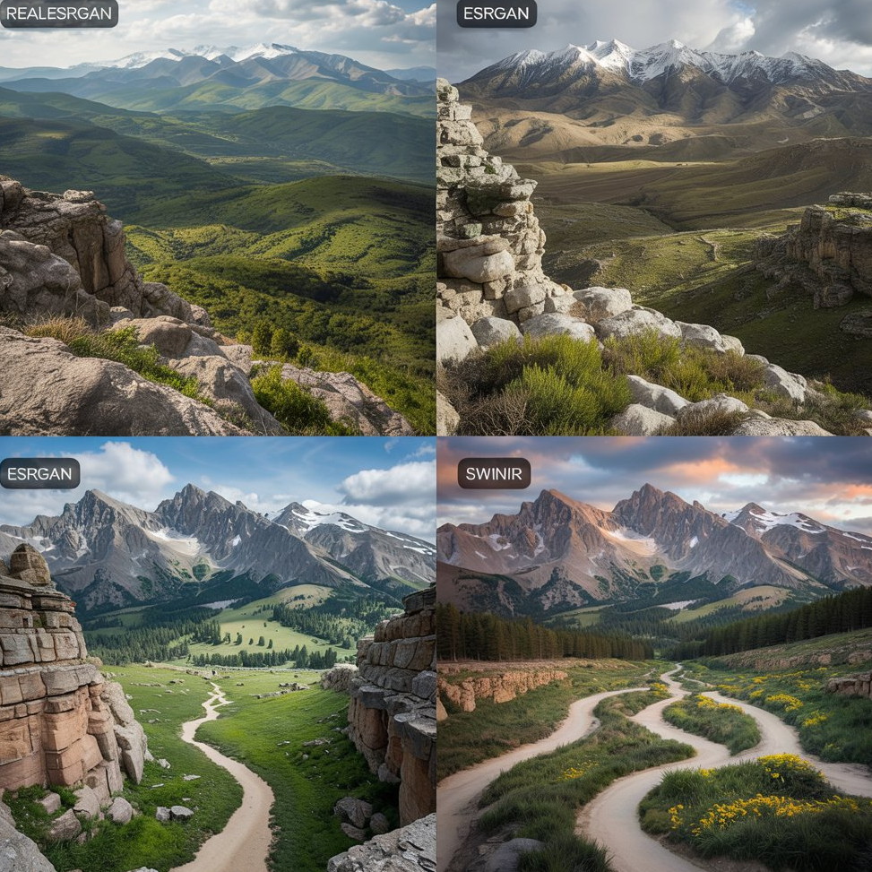

# 📌 Image Super-Resolution: Real-ESRGAN, ESRGAN & SwinIR

#       🚀 Overview
> **Scope note:** this top-level section describes the legacy Jupyter notebooks only. The DetailFrame WinUI app (see the DetailFrame section below) ships an empty model catalog and does not yet support any of these models or include verified weights.

The legacy notebooks implement and compare three popular deep-learning-based image super-resolution models:

-    Real-ESRGAN 🏆

-    ESRGAN 📈

-    SwinIR 🔍

These models enhance low-resolution images by reconstructing high-quality, high-resolution outputs.

#       📂 Repository Structure

        /models.zip                       # Pre-trained model files  
        /Real_ESRGAN.ipynb                 # Implementation of Real-ESRGAN  
        /Real_ESRGAN (1).ipynb             # Alternative implementation  
        /Real_ESRGan,_ESRGan,_SwinIR_implementation&comparison.ipynb  # Model comparison  
        /realesrgan_enhanced.jpg           # Output of Real-ESRGAN  
        /swinIR_enhanced_image.jpg         # Output of SwinIR  

#       🔧 Requirements
Ensure you have the following dependencies installed:

-    Python 3.8+ 🐍

- PyTorch ⚡

-    OpenCV 📷

-   NumPy 🔢

 -  Matplotlib 📊
 To install all dependencies:
        
        pip install -r requirements.txt
#       🎯 Models Implemented
🔹 Real-ESRGAN
- Uses enhanced SRGAN architecture

- Robust against different degradations

- Suitable for real-world images
🔹 ESRGAN

- Improves upon SRGAN with residual-in-residual dense blocks

- Generates sharper and more detailed images

🔹 SwinIR

- Transformer-based model for image restoration

- Outperforms CNN-based models on benchmarks
#       📊 Comparison

| Model  |  Performance | Speed | Suitable For  |
|-----------|-----------|-----------|-----------|
| Real-ESRGAN     | ✅ High    | ⚡Fast    | Real-world images    |
| ESRGAN     | 🔥 Very High    | 🐢 Slower    | Synthetic images   |
| SwinIR    | 🌟 Excellent    | 🚀 Moderate   | General enhancement

   #    🔥 Usage
   🖼️ Enhancing an Image

Legacy notebooks only (not the DetailFrame app). Run the appropriate notebook and execute the inference code; the command below assumes an `enhance.py` script that is not part of this repository:

        python enhance.py --input image.jpg --model real-esrgan
Change real-esrgan to esrgan or swinir as needed.

# 🪟 DetailFrame for Windows (WinUI 3 shell)

Build and test (Windows 11 target; builds require Windows 10 version 2004 / build 19041 or later, .NET 10 SDK):

    cd worker
    uv sync --frozen --extra dev
    .venv\Scripts\python.exe -m pytest tests -q
    cd ..
    dotnet test DetailFrame.sln
    dotnet build src/DetailFrame.App/DetailFrame.App.csproj -c Release -p:Platform=x64
    src\DetailFrame.App\bin\x64\Release\net10.0-windows10.0.19041.0\DetailFrame.App.exe

Branding assets live in `src/DetailFrame.App/Assets/Branding/` (ICO, SVG, PNG 16-256 px). Provenance and SHA-256 hashes are in `SOURCES.sha256` there; the ICO is also the executable and window icon.

The shipped model catalog (`shared/models.json`) is currently empty, so no real enhancement can run yet; the workflow is covered by tests with a fake worker.

The .NET integration tests require `worker\.venv\Scripts\python.exe` and its worker development dependencies; missing prerequisites fail the tests rather than silently skipping them.

The installed app and worker use the catalog, schema, reviewed manifest files and the canonical `shared\reviewed-manifests.json` trust data in the app's installation directory, never in the user model cache. The trust file maps lowercase SHA-256 manifest digests to model IDs and must remain empty until each exact manifest is independently reviewed. Verified downloads are stored per user at `%LOCALAPPDATA%\DetailFrame\Models\<sha256>\<filename>`; downloads are limited to 4 GiB even when no size is listed. Worker diagnostics use rotating files under `%LOCALAPPDATA%\DetailFrame\Logs` (1 MiB per file, three backups) and omit image paths and content. The empty production manifest trust data remains a release gate for every model.

Installer compilation, installation and upgrade/uninstall, clean Windows 11 VM testing, manual UI/accessibility checks, rebuilding the release-staged worker, and real model-backed inference remain unverified release gates; see `tests/release/release-checklist.md`.

## Windows 11 manual acceptance checklist

- [ ] App launches; window and taskbar show the DetailFrame icon.
- [ ] Theme follows Light / Dark / High contrast switches while running.
- [ ] Keyboard only: Tab reaches sidebar, every page control and the comparison viewport; Enter/Space activate; focus is always visible.
- [ ] Choose image: picker and drag-and-drop accept PNG, JPEG and WebP; other files show a readable error.
- [ ] Enhance: progress is announced, Cancel stops the job, a failed or cancelled run keeps the previous result.
- [ ] Compare: arrow keys move the divider, + / - / 0 zoom, wipe and zoom stay synchronized between both images.
- [ ] Save As: PNG, JPEG and WebP write the file; a missing WebP codec shows an actionable message.
- [ ] Error states are readable with Narrator and do not rely on colour alone.